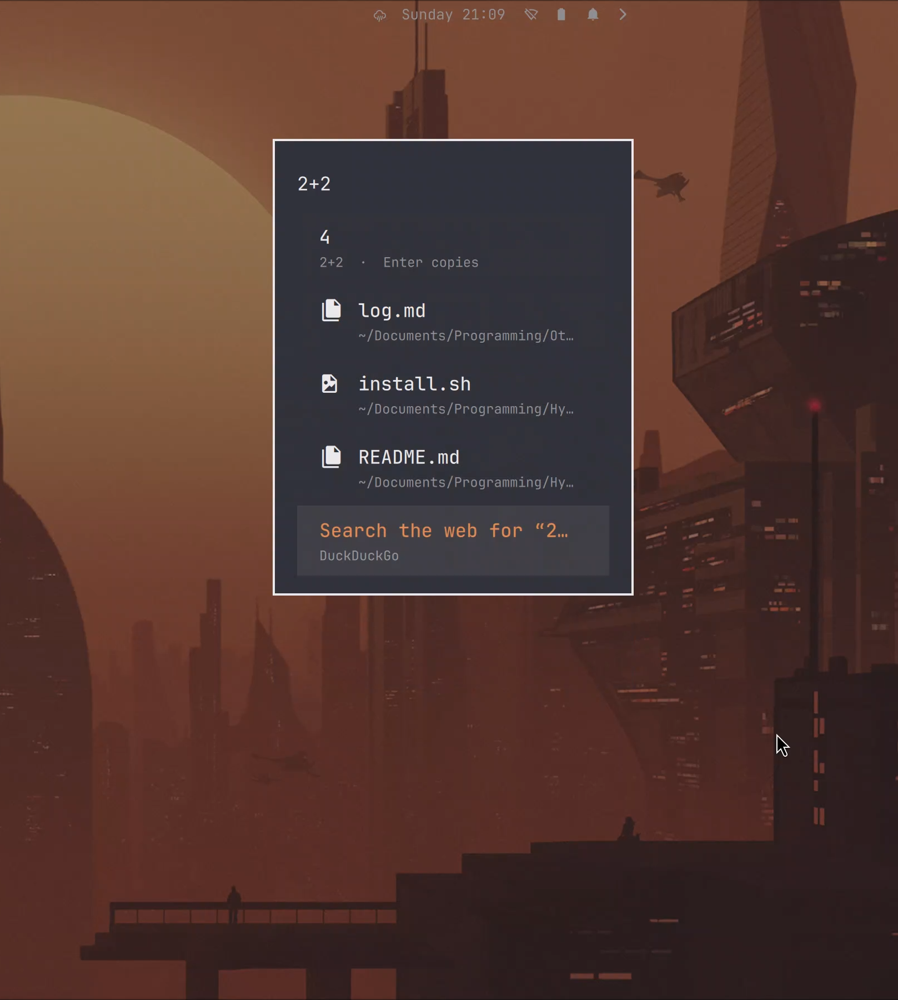
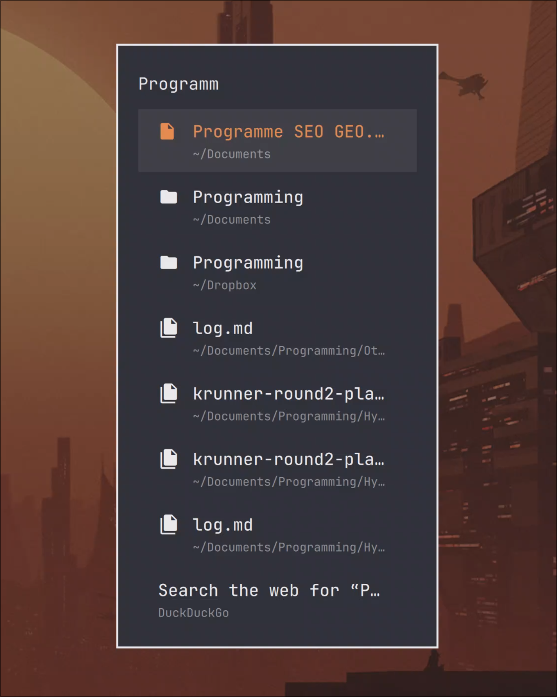
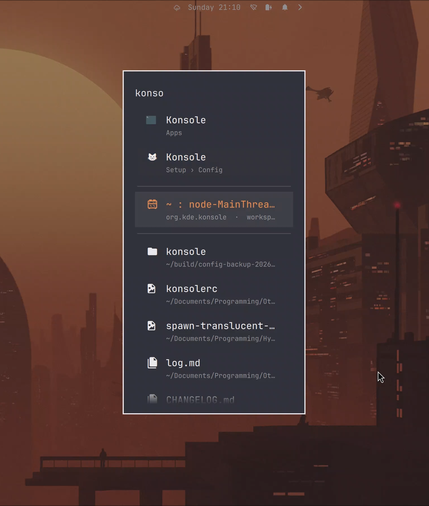
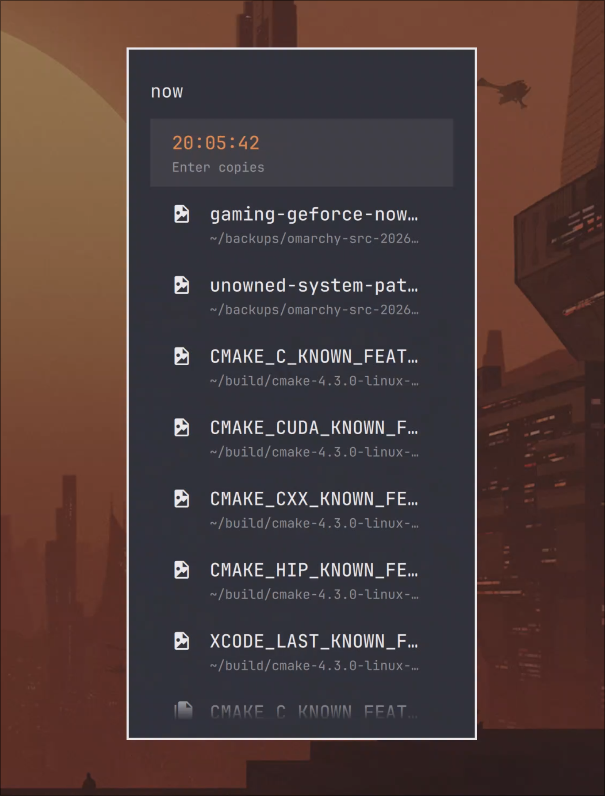

# Omarchy Launcher, improved

More functions, more practicality, more power. Implemented the following:
- websearching
- finds files & folders
- right click to copy path to clipboard
- calculations
- unit conversion
- full-text search
- window switching
- recent documents with learning rankings

All in the same minimal menu, with zero new daemons.

<p align="center">
  
  
</p>

<p align="center">
  
  
</p>

## What you get

Type in the launcher (≥ 2 characters, or any `=`-expression):

| You type | You get |
|---|---|
| `2+2`, `sqrt(2)*10`, `2^10`, `(1+2)*3`, `max(3,7)` | A math answer row — **Enter copies the result** |
| `=2+2` | Forced calculator mode: *only* the answer, nothing else |
| `10 km in mi`, `1 gb in mib`, `100 f in c`, `5 kg in pounds` | Unit conversion (SI + IEC bytes, length, mass, time, speed, temperature) — Enter copies the **numeric value** (the row shows the unit) |
| `date`, `time`, `now`, `today` (+ `heure`) | Current date/time — Enter copies |
| any file/folder name | Matching files **and folders** from `$HOME` (fd-powered, ~50 ms; hidden and gitignored paths skipped) — Enter opens, **Ctrl+Enter reveals the containing folder**, **right-click copies the path** |
| words that appear inside files | A second tier of Baloo full-text hits, marked `· content` |
| a word from an open window's title or app id | Open-window switcher rows — Enter focuses that window |
| anything | Your 5 most recent documents and 3 Dolphin places, liveness-checked, ranked above the rest |
| anything | A "Search the web for …" fallback row (DuckDuckGo) |

### How answers coexist

Auto-detected math, conversions, and dates **share the list** with menu items,
files, windows and content hits (that's why `2026-10-11` shows both `2005` *and*
your dated files). A **leading `=` is exclusive**: it suppresses every other
tier — `=hello` shows nothing at all.

### Frecency (it learns)

Opening a file/folder or focusing a window records a hit
(`~/.local/state/omarchy/launcher-frecency.json`, capped at 300 keys, no
analysis leaves the machine). Frequently used items quietly climb the file and
window rankings; the boost is capped so a favorite can outrank, never dominate.

## Requirements

- An Omarchy-style shell checkout with the `omarchy.menu` plugin
  (`~/.local/share/omarchy/shell/plugins/menu/`) running under Hyprland +
  Quickshell (tested: Quickshell 0.2.1, Hyprland 0.56.2 with the lua dispatch)
- `fd` — file/folder search
- `hyprctl` — window switcher
- `wl-copy` (wl-clipboard) — copy actions
- optional: `baloosearch6` + a running Baloo index — content search tier
  (without it the tier is simply empty; nothing breaks)
- optional: `git` or `patch` — only for the menu-ranking patch; the pack
  installs fine without them (ranking falls back to upstream behavior)

## Install

```sh
git clone https://github.com/IsseyShiitake/omarchy-launcher-v2.git
cd omarchy-launcher-v2
bash install.sh
```

The installer:

1. checks dependencies and tells you which tiers any missing one degrades,
2. backs up every file it touches to `~/.local/share/omarchy-backups/launcher-krunner/<timestamp>/`,
3. copies in the enhanced files (and `~/.local/bin/ravi-window-focus` for window focusing),
4. applies the optional 5-line menu-ranking patch (skipped harmlessly if your base differs),
5. restarts the shell if it can (Quickshell has no QML hot-reload — log out/in otherwise).

Re-running `bash install.sh` is a safe update: it re-backs-up and overwrites.

## Uninstall / rollback

```sh
bash uninstall.sh
```

Restores the newest backup (or the pristine files from the Omarchy git
checkout if no backup exists). The frecency state file is inert without the
pack — keep or delete it.

## What it modifies

| File | Change |
|---|---|
| `shell/plugins/menu/Menu.qml` | All new tiers, answer rows, frecency, right-click copy (drop-in replacement) |
| `shell/Ui/OverlayWindow.qml` | Holds overlay geometry ~280 ms on close so the menu's fade-out can play (drop-in replacement) |
| `shell/plugins/menu/MenuModel.js` | Optional: leaf actions rank above submenu containers (applied as a patch) |
| `~/.local/bin/ravi-window-focus` | New helper: focuses a window by address via Hyprland's lua dispatch |

`patches/omarchy-shell-menu-krunner.patch` is the complete, reviewable diff of
all three files against upstream Omarchy shell commit `821ae58` — if you run
that base you may `git apply` it instead of copying files. The patch covers
those three files only: also install the window-focus helper with
`install -Dm755 files/ravi-window-focus ~/.local/bin/ravi-window-focus`
(without it the window rows still appear but Enter cannot focus anything —
`Menu.qml` looks the helper up under `$HOME/.local/bin`).

## Compatibility

Tested against Omarchy shell `821ae58` (2026-10-02), Quickshell 0.2.1,
Hyprland 0.56.2 on Fedora 44. The QML is defensive: missing binaries, empty or
malformed recents/places files, and unreadable JSON all degrade to empty
tiers rather than errors. Newer upstream `Menu.qml` versions may drift —
prefer the patch route if your base matches, and re-check after Omarchy
updates. An `omarchy update` that pulls newer upstream files can conflict
with these; if the launcher misbehaves after an update, re-run
`bash install.sh` (it re-backs-up and re-applies).

## Privacy notes

File search covers `$HOME` only, using fd's defaults (hidden and gitignored
paths skipped, no symlink following). Window rows read `hyprctl clients`.
Nothing is sent anywhere; the only fallback row is an explicit web search you
choose to press Enter on.

## Credits & license

Built on top of [Omarchy](https://omarchy.org) by DHH and contributors — the
three modified files derive from the Omarchy shell (MIT). This pack is released
under the MIT License too; see [LICENSE](LICENSE).
